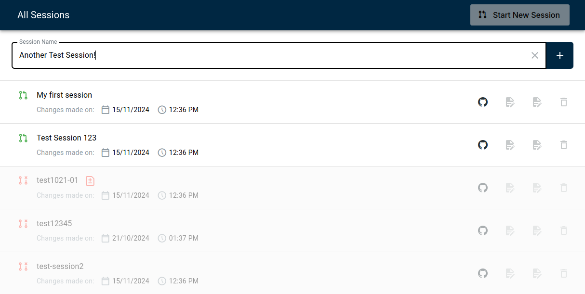

# git-clerk

An Open-Source Content Management System based on Git workflows with a friendly file-editing GUI.



## Purpose

The GitHub UI offers a lot of functionalities which can be overwhelming with users not familiar with Git. This software offers an abstraction on top of GitHub to allow easy creation of forks, PRs, and commits on behalf of the user. On top of that, it offers an automatically rendered form GUI (based on provided JSON schemas) which makes the creation of files easier.

## Functionality

As soon as the user starts a new "Session" (PR), a fork for the target repository is automatically created for the user if not yet present. It also creates an empty commit and a PR for the user. As soon as the user creates/changes files, these are "saved" as commits. Then, the user can mark a session as ready (turn the draft PR into an open PR), and receive feedback regarding failing pipelines or requested changes on the PR.

## Configuration

The configuration for git-clerk is done via the [config file](/public/config.js) by setting `globalThis.gitClerkConfig`. In its most basic form, the config looks like this:

```js
globalThis.gitClerkConfig = {
  // The target repository to create PRs against
  githubRepo: "EOX-A/git-clerk-demo",
  // The current user's GH token, either as string or (sync or async) function
  // Example: githubAuthToken: () => "<github-token>"
  // Example: githubAuthToken: () => new Promise((resolve) => fetch("<endpoint>").then(() => resolve(token))),
  githubAuthToken: "ghp_myGithubAuthToken",
};
```

You can also set this GitHub config via an `.env` variable, by passing `GITCLERK_GITHUB_TOKEN` and `GITCLERK_GITHUB_REPO` see e.g. [.env.example](./.env.examle).

### Permission required by GitClerk on GitHub

| Permission           | Classic token / OAuth App                         | GitHub App                    | Fine-grained PAT                                                                 | Needed for                                                  |
| -------------------- | ------------------------------------------------- | ----------------------------- | -------------------------------------------------------------------------------- | ----------------------------------------------------------- |
| Repository access    | `repo` (or `public_repo` if everything is public) | Metadata: Read                | Metadata: Read, plus access to the target and the forks under the resource owner | Reading repos and forks                                     |
| Contents             | `repo`                                            | Contents: Read and write      | Contents: Read and write                                                         | Files, branches, commits, forks, merge-upstream             |
| Pull requests        | `repo`                                            | Pull requests: Read and write | Pull requests: Read and write                                                    | Sessions (create, list, rename, close, submit for review)   |
| Checks               | `repo`                                            | Checks: Read                  | Checks: Read                                                                     | CI status on sessions                                       |
| Organisation members | `read:org`                                        | Members: Read                 | Members: Read (only when the resource owner is an organisation)                  | Organisation forks, only with `forkingLocation.org`         |
| Workflows            | `workflow`                                        | Workflows: Read and write     | Workflows: Read and write                                                        | Optional, only for editing files under `.github/workflows/` |

**Notes:**

- A GitHub App must be installed on the user's account and in every organisation whose fork should be usable.
- A fine-grained PAT has a single resource owner, so it cannot combine personal and organisation forks.

## Features

### `schemaMap`

With the `schemaMap`, one can configure which file paths are associated with which JSON schemas to automatically render input forms.

#### `schema` and `url`

```js
globalThis.gitClerkConfig = {
  [...]
  schemaMap: [
    {
      path: "/folder-a/file.json",
      schema: {
        title: "my-schema",
        type: "object",
        properties: {
          foo: {
            type: "string"
          }
        }
      },
      jsonform: {
        options: {} // jsonform options
      }
    },
    {
      path: "/folder-a/<id>/file.json",
      url: "https://my-schema-site.com/schemas/folder-a/schema.json",
    },
    [...]
  ],
  [...]
};
```

In this example, editing the file `/folder-a/file.json` loads the corresponding JSON schema passed via the `schema` property, whereas editing a file with the pattern `/folder-a/<id>/file.json` loads the corresponding JSON schema `https://my-schema-site.com/schemas/folder-a/schema.json`.
A dynamic path placeholder segments starts and ends with `<...>` eg - `<title>`, `<date>`, `<id>`, `<lorem-ipsum>` etc, which loads the corresponding JSON schema.

#### `content`

Additionally to providing a JSON schema, the form can also be autofilled with initial content:

```js
globalThis.gitClerkConfig = {
  [...]
  schemaMap: [
    {
      path: "/folder-a/file.json",
      schema: {
        title: "my-schema",
        type: "object",
        properties: {
          foo: {
            type: "string"
          }
        }
      },
      content: {
        foo: "bar"
      }
    },
    [...]
  ],
  [...]
};
```

In this example, the generated form will automatically fill the value "bar" into the `foo` field.

#### `output`

By default, the entire JSON structure is stored (commited) as a JSON file. But one can also specify a specific property which should be stored in the file instead. This is handy when e.g. editing markdown or yaml files:

```js
globalThis.gitClerkConfig = {
  [...]
  schemaMap: [
    {
      path: "/folder-a/file.md",
      schema: {
        title: "my-schema",
        type: "object",
        properties: {
          foo: {
            type: "string",
            format: "markdown"
          }
        }
      },
      output: "foo"
    },
    [...]
  ],
  [...]
};
```

In this example, the markdown content of `foo` is commited as file `file.md`.

#### `preview`

If a `preview` is defined, then the editor GUI only takes half of the screen, and the other half renders the referenced preview HTML inside an iframe. Whenever the editing form updates, it sends a `postMessage` including a `CustomEvent` to the preview iframe with the `event.type` of `SCHEMA_DATA_EDITOR_UPDATE` and the `event.detail` being the JSON output of the editor. The preview iframe can also emit a `CustomEvent` to the parent with the `event.type` of `SCHEMA_DATA_PREVIEW_UPDATE`, which then updates the editor (in `event.detail` it expects the JSON value that matches the currently loaded JSON schema).

An example for this setup can be seen in [here](https://github.com/EOX-A/git-clerk/blob/f658c6ec4604d6f0da7fe237f3f56e27a8fa0e58/public/storytelling.html).

### `automation`

Sometimes, multiple edits need to be done together (e.g. creating a file in the correct folder structure, putting initial content in that file, and referencing this file in a third file). To make users' lives easier, git-clerk offers automations:

```js
globalThis.gitClerkConfig = {
  [...]
  automation: [
    {
      title: "Bootstrap Product", // displayed in the UI as button
      description: "Bootstrap a new file with the correct folder structure and ID.", // displayed in the UI as description for this automation
      inputSchema: { // the input form when the user selects this automation
        type: "object",
        properties: {
          id: {
            type: "string",
            minLength: 1
          },
          title: {
            type: "string",
            minLength: 1
          }
        },
        required: ["id", "title"]
      },
      steps: [ // the steps the automation will perform
        {
          type: "add", // add a file
          path: (input) => `/products/${input.id}/collection.json`, // references the above defined form output property "id"
          content: (input) => ({ id: input.id, title: input.title }) // sets the content of the added file, referencing "id" and "title" from the form
        },
        {
          type: "edit", // edits an existing file
          path: "/products/catalog.json",
          transform: (content, input) => { // transforms the content of an existing file
            content.links = [
              ...content.links,
              {
                rel: "child",
                href: `./${input.id}/collection.json`,
                type: "application/json",
                title: input.title
              },
            ]
            return content
          }
        },
        {
          type: "navigate", // navigates to the specified file and opens the editing view
          path: (input) => `/products/${input.id}/collection.json`
        }
      ]
    },
    [...]
  ],
  [...]
};
```

Automations can also be triggered via -

1. URL Query Parameters - for this, the automation requires an additional `id` parameter which is referenced by the `automation` query parameter. The automation can be triggered within a session, or you can supply `session` or `sessionNumber` parameters:
   - `session`: The title of the session. If an open session/pull request with this exact title already exists for the user, git-clerk will reuse and open that existing session. If no matching open session is found, it will automatically create a new one. (Note: If a name collision occurs on GitHub, such as during manual creation or with closed/orphaned branches, git-clerk will still automatically append an incremented suffix like `(1)`, `(2)`, etc., to prevent branch collisions).
   - `sessionNumber`: The specific number of an existing session (pull request) to target directly.

   All other query parameters (except `automation`, `session`, and `sessionNumber`) are passed as key-value pairs into the automation input (and thus can further be used in automation steps).

   Example:`https://my-git-clerk-instance.com?session=My New Session&automation=automation-id&field1=value-field1&field2=value-field2`

2. `postMessage` from parent tab - when git-clerk is opened from another application, it sends an `'automation-ready'` message to its parent window or opener once it is loaded. The parent can then listen for this message and reply with a `postMessage` containing the automation data as a JSON string. The automation data should include `session` or `sessionNumber` (similar to url query params), `automation` (automation id), and any other key-value pairs required by the automation input. This is only applicable if `allowedOrigins` is provided in `config.js`.

   Example:

   ```js
   // config.js
   const allowedOrigins = ["http://example.website"];
   globalThis.gitClerkConfig.allowedOrigins = allowedOrigins;
   ```

   ```html
   <a href="/" target="_blank" rel="opener">Git Clerk</a>
   ```

   ```javascript
   const automationData = {
     session: "My New Session",
     automation: "automation-id",
     field1: "value-field1",
     field2: "value-field2",
   };
   let readyAutomation = false; // This will prevent event from triggering multiple times.
   window.addEventListener("message", (event) => {
     if (event.data === "automation-ready" && !readyAutomation) {
       event.source.postMessage(JSON.stringify(automationData), "\*");
       readyAutomation = true;
     }
   });
   ```

Example - [external automation through js](/public/example-external-automation.html)

### Custom Editor Interface

Git Clerk uses `eox-jsonform` to render applications based on different JSON editor schemas. `eox-jsonform` contains editor interfaces for each of the primitive JSON types as well as a few other specialized ones. For those who need custom editor interfaces/inputs based on any custom format, they can easily build their own custom editor interface using `JSON Editor`'s `AbstractEditor` class inside `config.js`.

```js
globalThis.gitClerkConfig = {
[...]
customEditorInterfaces: {
 "some-format-key-name": {
   type: "string", // Any data type for the custom editor
   format: "any-custom-format", // Any custom format key
   func: CustomEditorInterface, // Build any custom editor using `JSON Editor`'s `AbstractEditor` class
   ... // Add any key values as per your business logic
 },
},
[...]
};
```

An example for this setup can be seen in [here](https://github.com/EOX-A/git-clerk/blob/bfa157a499ef488fe3b0ebf3215fb9368d552496/public/config.js#L680).

### Generate Enums

Sometimes input enums need to be dynamically fetched from an API or other data source to update the schema. `globalThis.gitClerkConfig.generateEnums` inside `config.js` allows users to fetch dynamic enums according to their business logic and then return the updated schema.

```js
globalThis.gitClerkConfig = {
  [...]
  generateEnums: async (
    schemaMetaDetails,
    session,
    cache,
    { getFileDetails },
  ) => {
    ... // Fetch dynamic enums based on the API and update the schemaMetaDetails
    return schemaMetaDetails; // Return the updated schema based on the processing above
  },
  [...]
};
```

An example for this setup can be seen in [here](https://github.com/EOX-A/git-clerk/blob/bfa157a499ef488fe3b0ebf3215fb9368d552496/public/config.js#L724).

### Deployed Preview Link

Git Clerk allows you to configure a custom preview link for your sessions/PRs. This can be useful if you have preview deployments set up for your sessions. You can configure this by adding a `deployedPreviewLink` function to your config that returns the preview URL:

```js
globalThis.gitClerkConfig = {
  [...]
  deployedPreviewLink: (sessionDetail) => {
    const { number } = sessionDetail;
    return `https://deploy-preview-url.com/${number}/preview.html`;
  }
  [...]
};
```

### Disable manual file creation

Git Clerk allows you to configure and disable manual file creation. This can be useful if you like the user to only use automation and editing the files. This will disable manual file creation and upload in file browser and suggestion in empty session. You can configure this by adding a `disableManualFileCreation` function to your config that returns a boolean value:

```js
globalThis.gitClerkConfig = {
  [...]
  disableManualFileCreation: true // boolean value - true or false
  [...]
};
```

### Add internationalization

Git Clerk allows you to configure I18n (internationalization) using config. This can be useful if you like the users to have textual content in different languages. You can configure this by adding a `i18n` constant to your config that returns an i18n options:

```js
globalThis.gitClerkConfig = {
  [...]
  i18n: {
    locale: "en",
    fallbackLocale: "en",
    messages: {
      en: {
        buttonText: {
          automation: "Automation",
        },
      },
      de: {
        buttonText: {
          automation: "Automatisierung",
        },
      },
    },
  }
  [...]
};
```

You can read more about i18n options [here](https://vue-i18n.intlify.dev/guide/essentials/syntax).

### Organisation forks and roles

By default every user works in her/his own fork and sees only the sessions (PRs) whose branch lives in that fork. With `forkingLocation` you can additionally allow sessions in an **organisation fork** that is shared by all members:

```js
globalThis.gitClerkConfig = {
  [...]
  forkingLocation: {
    personal: true, // sessions in the user's personal fork (default: true)
    org: true, // sessions in organisation forks (default: false)
  },
  [...]
};
```

When `org` is enabled, git-clerk lists the organisations the user is a member of (this needs a token with the `read:org` scope) and, in the same load step, asks GitHub for the forks of the target repository the user is affiliated with (owned, outside collaborator, or through an organisation membership). Org forks the user can push to without being a member are added as well. The resulting roles are:

| Role                                            | Fork repo                                                 | View sessions                    | Create session                           | Edit files          | Rename / Delete / Submit |
| ----------------------------------------------- | --------------------------------------------------------- | -------------------------------- | ---------------------------------------- | ------------------- | ------------------------ |
| **Repo member** (write on target)               | Personal ✅, Org ✅                                       | All PRs ✅ (native + every fork) | Personal ✅, Org ✅                      | ✅ all              | ✅ all                   |
| **Personal** (no write, no org)                 | Personal ✅, Org ❌                                       | Personal ✅, Org ❌              | Personal ✅, Org ❌                      | Personal ✅, Org ❌ | Personal ✅, Org ❌      |
| **Org member**                                  | Personal ✅, Org ✅ (unless the org forbids member forks) | Personal ✅, Org ✅              | Personal ✅, Org ✅                      | Personal ✅, Org ✅ | Personal ✅, Org ✅      |
| **Outside collaborator** (write on an org fork) | Personal ✅, Org ❌                                       | Personal ✅, Org ✅              | Personal ✅, Org ✅ (existing fork only) | Personal ✅, Org ✅ | Personal ✅, Org ✅      |
| **Read-only collaborator**                      | Personal ✅, Org ❌                                       | Personal ✅, Org ❌              | Personal ✅, Org ❌                      | Personal ✅, Org ❌ | Personal ✅, Org ❌      |

A scope switcher above the sessions list toggles between _All PRs_ (repo members: everything, the default) or _All Repos_ (everyone else: personal plus every organisation fork, the default), _Personal_, and each organisation that already holds a fork. Session branches in an org fork are still prefixed with the user's login (`<login>/<slug>`), so members never collide. In organisation scope each session shows its author. Everyone with push access to the org fork can edit files in any of its sessions.

External automations can target an organisation fork by adding `forkOwner: "<org-login>"` to the payload or query parameters.

## Development

### Recommended IDE Setup

[VSCode](https://code.visualstudio.com/) + [Volar](https://marketplace.visualstudio.com/items?itemName=Vue.volar) (and disable Vetur).

### Customize configuration

See [Vite Configuration Reference](https://vitejs.dev/config/).

### Project Setup

```sh
npm install
```

#### Compile and Hot-Reload for Development

```sh
npm run start
```

This starts both versions in separate Vite servers:

- v1: `src/`, Vue and Vuetify, at http://localhost:3000.
- v2: `src-v2/`, Vue and Tailwind CSS, at http://localhost:3001.

To run either version independently:

```sh
npm run start:v1
npm run start:v2
```

V2 shows a centered chat starter at `/` and a selected session at
`/:sessionNumber`, without reloading the page. The starter accepts local draft text and removable file attachments, automation
templates with editable blanks, and model selection from the design reference.
Attachments stay in memory; nothing is uploaded. Repository selection is hidden,
speech input is removed, and both root and session composers support the console-only API test below.
The centered **Create Session** link below the composer opens a session-name modal
with the v1 “What is a session?” explanation. The Git broker creates a draft PR
on a `session/<user_slug>/<session_slug>` branch in the configured repository.
A retry checks uncertain results without creating a duplicate session.
`src-v2/main.js` mounts the app configured in `src-v2/app.js`; `src-v2/App.vue`
keeps navigation mounted around the router. Navigation components live in
`src-v2/components/nav/` and support a collapsed rail, mobile drawer, and light/dark
appearance. The sidebar starts at 264 px; drag its right edge to resize
between 240 and 360 px on desktop. Double-click the edge to reset, or focus it
and use the arrow keys (Enter resets).

V2 uses the Git broker for repository requests. In `public/config-v2.js`, set
`globalThis.gitClerkConfig.gitBrokerUrl` to the workspace gateway path, for example
`/services/eoxhub-gateway/<workspace>/eox-git-broker-mcp`. For local development it
uses `http://localhost:8015`. Optional `gitBroker: { provider, repo }` settings override
the backend's repository selection; set `provider` explicitly for GitLab or Forgejo.
V1 continues to use `public/config.js` and its own GitHub configuration and credentials.

V2 uses `name`, `email`, and `preferred_username` from Luigi's `context.user`.
Missing fields fall back to `GITCLERK_PROFILE_NAME`, `GITCLERK_EMAIL`, and
`GITCLERK_USERNAME` from Git Clerk's `.env` file. Restart Vite after changing
these variables. The sidebar profile and theme controls appear when all three
profile fields come from the environment. Git Clerk follows the user area's
theme from `context.darkMode` at startup and on context updates. V2 sends the
resolved profile as `author: { name, email, username }` on file publish and delete requests. The
username must resolve to the user slug the gateway enforces. The gateway supplies
identity to the broker; v2 does not send provider credentials. For local development,
configure repository access on the broker and run the updated version that exposes
`GET /api/git/repo` and the remaining Git REST routes.

The sidebar shows every PR returned by the broker, regardless of author or branch.
Filter and sort changes fetch fresh pages. Selecting a session loads its current
branch, checks and review status. Session actions use the broker's rename, review
submission, and close/delete routes. File edits still require an open session in
the user's branch namespace. `src-v2/api/index.js` keeps these operations behind the
UI boundary.

V2 chat is configured by one `globalThis.gitClerkConfig.chat.preset` per instance
in `public/config-v2.js`; there is no preset picker or registry. Existing configuration
sections (GitHub, schemaMap, previews, authentication) remain independent.
The shared application has no OSC/narrative branches or built-in project IDs.
`projectId` is sent to the backend; it does not select frontend behaviour. Set it
explicitly for a deployment, or omit it to use the backend's default project.
Prompts, file examples, context filters and chat wording come from the single
preset. Editor schemas and automation workflows remain in the existing top-level
`schemaMap` and `automation` configuration, independently of chat. `contentType` is no longer used.
The supplied OSC example sends replies through the existing agentic backend's
`POST /api/generate` (`profile: "chat"`, `output_format: "text_and_a2ui"`,
`project_id: "earthcode-osc"`, `stream: true`). A compact prompt requests
`{ message, draft: { title, files } }`; clarification replies use `draft: null`.
The conversation and current file draft travel in the existing `history` field.
The OSC example uses the chat profile because the backend's generic JSON profile ignores history.
The frontend parses the requested JSON from the chat profile's text response,
including fenced JSON and trailing citations. Follow-up chat requests include
`X-Git-Session-Branch` so the agentic backend can
constrain Git tools to the currently open branch. The frontend sends final files
to `POST /api/git/publish` on the Git broker, reads back the corresponding PR,
and uses the confirmed commit to refresh the editor. Chat and Git use separate URLs.

Publishing sends complete generated files without schema checks or repository
preflight requests. For GitHub updates, the broker builds from the session branch
and looks up the existing PR if PR creation returns 422. This keeps existing files
and commits in the session. The broker currently has no expected-head guard;
concurrent writes can still race. Both manual and AI sessions start as draft PRs.
For a new AI session, Git Clerk creates the draft with `POST /api/git/pulls`, then
saves generated files to its branch with `POST /api/git/publish`. This supports
updates to existing files and sends the configured author for the file commit.
The app opens the draft PR with the conversation and file cards intact. Use
**Submit for review** to mark it ready.
After a confirmed chat update, open files receive the saved contents immediately
without re-fetching files or editor schemas. The current editor/preview mode is
preserved; ordinary background metadata refreshes continue.
Assistant replies use `vue-stream-markdown` inside the existing Tailwind chat layout
for headings, lists, tables, links and code blocks. File cards appear incrementally
as draft JSON arrives, with expandable, bounded JSON previews. Generated and publishing
states remain separate from the confirmed Saved state; the PR result card appears
only after publication succeeds. Raw HTML, embedded remote images and executable
links are disabled. File previews remain plain text. Chat follows new content only
while the reader remains at the bottom, including asynchronous Markdown rendering.
After a page refresh, an empty session chat shows a Git Clerk greeting and a live
PR summary with status, changed-file count, checks, branch and links to Changes
and the repository. This uses the already-loaded session metadata; it does not restore
previous conversations or send a dummy message to the AI.
Retries reconcile a lost response by reading the branch, its exact files and PR;
they never blindly resend a request whose outcome is uncertain. A confirmed result
is retained if loading the PR fails. No base-branch concurrency check runs before
publishing. Saved chat file cards use “Saved” because the frontend no longer reads
previous contents to classify files as added or modified. No live Git writes occur in tests.

Start the agentic backend on port 8000 and the Git broker on port 8015 for local
development, then send an OSC request such as
“Create a synthetic sample OSC product, project and variable.” AI publishing skips
OSC schema and naming validation for now. Paths with spaces, Unicode, underscores
or nested directories are passed through unchanged; no OSC folder, filename,
content-type or per-file size/count rules block publication. Only the response
envelope and repository-relative addressing are checked (no traversal segments).
Strings are sent as file text; other JSON values are serialized. No schema fetch
or JSON Form validation runs before AI publication. The top-level `schemaMap` example supplies
OSC manual-editor schemas for parent catalogues and child files in `products`, `projects`,
`variables`, `themes` and `eo-missions`, using the official
`esa-earthcode.github.io/open-science-catalog-validation/schemas` URLs. Matching
runtime `schemaMap` entries configure custom editors and
previews for the manual file editor. Incomplete responses and streaming errors are
shown in chat and do not start a save. Retry saving reuses the generated draft
without another generation request.
For a browser regression check of the manual file validator, run `npm run test:workspace:v2`
and open `http://127.0.0.1:3002/test/fixtures/v2-workspace/validation.html`.
It uses a local official product schema snapshot and synthetic data to check valid
and invalid files, including spatial fields, without GitHub or LLM requests.
The same page can validate a pasted `draft.files` object against the hosted default
schemas from the top-level example configuration. Schema path placeholders match one directory
segment, including spaces and Unicode, without enforcing OSC ID rules. Errors
identify the rejected file.
A failed broker request can leave a branch without a PR; retry checks the outcome
and reports this partial result without overwriting the branch. Sandbox/dry-run
responses never count as a live publication.
The backend's summary-only responses are not treated as file bundles, and its
self-reported validation scores do not authorize saving.
Both generation and broker calls use `gitClerkConfig.chat.backend.baseUrl`
(default `http://localhost:8000`). The former agentic URL environment variable is
no longer read. `backend.stream` defaults to `true`; setting it to `false` uses the
backend's JSON response instead of SSE. Reload the app after editing config-v2.js.
LLM credentials belong in the backend environment, never in the frontend `.env`.

The chat configuration supports:

| Setting                                        | Behaviour                                                                                                                                                                                         |
| ---------------------------------------------- | ------------------------------------------------------------------------------------------------------------------------------------------------------------------------------------------------- |
| `enabled`                                      | Show/hide AI chat; manual sessions and file editing remain available.                                                                                                                             |
| `preset.projectId`, `profile`, `output_format` | Values sent to `/api/generate`. The project must exist on the backend.                                                                                                                            |
| `preset.fileExample`                           | File map example embedded in the shared draft contract; defaults to a path with complete text content. The OSC preset supplies a JSON object example.                                             |
| `preset.prBody`                                | New-PR description for this preset. An explicit `publishing.prBody` overrides it.                                                                                                                 |
| `preset.prTitle`                               | Title template for new AI PRs. Default: `<title> (<username>)`. `<id>` is also available. An explicit `publishing.prTitle` overrides it.                                                          |
| `preset.promptInstructions`                    | Short content-specific instruction before the shared response contract. Counts toward the backend prompt limit.                                                                                   |
| `preset.context.inputField`                    | Optional backend field receiving the current `outputFile` text; use `markdownSection` for the Markdown editor. Unset by default.                                                                  |
| `preset.context.extensions`                    | Which changed files supply follow-up context; `[]` includes readable text files. This does not restrict publication paths. JSON is decoded when possible; Markdown and other text remain strings. |
| `preset.ui`                                    | Assistant/panel names, heading, description, initial/follow-up placeholders, session title, welcome/read-only welcome, progress wording, footer, disabled message and suggestion buttons.         |
| `features`                                     | Attachments and model selector visibility; manual session creation visibility. Attachments remain local-only and block sending if selected.                                                       |
| `preset.models`                                | Model options `{ label, value, description }`; the selected nonempty `value` is sent as `model`. Auto omits it. Use models supported by the backend.                                              |
| `publishing.enabled`, `automatic`              | Disable publishing, or set `automatic: false` to show **Publish changes** after generation.                                                                                                       |
| `publishing.updateExistingSession`             | Allow or disable follow-up publication into an existing PR.                                                                                                                                       |
| `publishing.serverId`, `toolName`, `prBody`    | Broker route and new-PR description. Replacement tools must implement the same publish-bundle contract.                                                                                           |

`public/config-v2.js` includes two complete chat examples: OSC and the narrative
editor (`NARRATIVE_CHAT_CONFIG`). Switch by commenting out one assignment and
uncommenting the other; keep only one active and reload the app. The narrative example uses `generic-eox`,
`profile: "markdown_editor"`, `output_format: "markdown"`, and
`outputFile: "stories/<id>.md"`. For a new chat, Git Clerk requests a short title
through the existing text mode of `/api/generate` while the main reply streams.
It builds `<id>` from the title with a short random suffix. If title generation
fails, Git Clerk uses the draft title, a Markdown heading, or the first prompt.
The narrative preset's PR title is `Publish: <title> (<username>)`. Follow-up
requests keep the existing file path and send the current file in
`preset.context.inputField: "markdownSection"`, matching the existing backend.
Other raw-output profiles can configure their own input field (for example `markdown`).

The top-level `schemaMap` entry for `/stories/<id>.md` uses `output: "Story"`:
the form edits `{ Story: markdown }`, while Git receives the original Markdown text.
Author metadata is not required. Its `/narrative-preview.html` iframe is based on
the supplied storytelling preview, preserving its pinned EOX storytelling, chart,
JSON Form and map imports. The companion `narrative-preview.js` connects
`SCHEMA_DATA_EDITOR_UPDATE` and `SCHEMA_DATA_PREVIEW_UPDATE` with `detail.Story`,
checks the parent window/origin, suppresses update echoes, and respects read-only
sessions. The preview opens by default; Source and Editor can be opened alongside it.
If CDN imports fail, the page shows the source with a loading error. Image uploads
are not connected in v2; the upload callback reports this instead of waiting for an
unsupported `FILE_UPLOADED` reply. Existing image URLs can still be used in narratives.

Missing fields inherit generic defaults: no project ID and no context extension
filter. Replacing the preset changes chat behaviour only; editor schemas and
automation workflows remain controlled by their top-level configuration. V2 chat
automation UI remains unavailable until workflow integration is implemented. The shared `{ message, draft }` envelope supports
both JSON objects and complete file-text strings. For a raw-output backend profile,
`preset.outputFile` explicitly maps its result into one repository file (for example
`stories/example.md` with a Markdown profile, or a JSON file with `output_format: "a2ui"`).
Without that mapping, ordinary text is displayed as a reply and does not publish.
Raw A2UI output can be saved as JSON; Git Clerk does not render an A2UI canvas.
Changing output format does not add backend capabilities or change its profile routing.
No frontend schema or OSC naming validation is enabled by this configuration.

Conversation state is kept in memory per backend, project/profile/format, signed-in account, repository and PR,
so it survives in-app navigation but not a page reload. Attachments are not yet
uploaded by this flow and block sending until removed.
AI publishing uses the existing broker tool through the agentic gateway. No direct
OSC REST requests, backend source changes or additional MCP tools are required.

Session chat floats over the file workspace or docks beside it, with pointer resizing and a
keyboard-adjustable divider. The file workspace stays available for closed/merged
sessions too; their chat composer becomes a read-only banner. There is no desktop
full-chat mode or Visualizer toggle. Mobile Chat/Files controls switch panels while
preserving drafts and open tabs. Session metadata refreshes preserve conversation
history; navigating away cancels the pending API request.

Session files open in tabs, with a Files/Changes drawer. Clicking either list
opens a normal file; “View changes” explicitly opens its saved PR diff.
Configured `schemaMap` previews use an iframe and the v1 postMessage contract.
Preview is the default when available. Editor (a configured `eox-jsonform`) and
Source are mutually exclusive and can both be switched off to show only the preview.
Files without a preview start in Source; files without a schema have no Editor.
The split divider supports dragging and arrow keys; narrow layouts show the
selected editing pane at full width. The read-only status tag follows the filename,
and “View file” opens the configured repository.

Drafts remain in memory across tab switches. Save changes or Ctrl/⌘+S validates
configured schemas, compares the current blob SHA with the opened version, commits
to the session branch through the Git broker,
and refreshes session details. Closing dirty tabs or leaving the session offers
Save/Discard/Cancel. Failed saves preserve drafts. Closed, merged, deleted and
unwritable files remain read-only; deleted files open on the base ref when it is available.
Binary, non-UTF-8 and files over 1 MiB can be opened in the repository.

For browser checks without credentials or real repository writes, run
`npm run test:workspace:v2`, then open
`http://127.0.0.1:3002/test/fixtures/v2-workspace/index.html`.
The fixture provides mock saves, conflicts, configured previews and forms.
Append `?create` to exercise manual session creation and redirection with mocked
broker responses. Append `?chat` for floating/docked/mobile chat, metadata refresh,
read-only state and unsaved-file navigation checks, also backed only by mocks.
The fixture routes chat requests to its own mock endpoint; it never calls the live
agentic backend or an LLM.

Run the focused API regression tests with `npm run test:v2` (mocked broker and agentic responses).

Temporary design references live in `src-v2/docs/` and are excluded from Tailwind
scanning and formatting. Design colours, typography, spacing, radii, and shadows
are defined as Tailwind tokens in `src-v2/assets/main.css`. It follows v1's JavaScript, Vue Composition API,
`@/` imports, and directory conventions, with feature folders added as they are implemented. Tailwind replaces Vuetify in v2, using the
[Tailwind Vite plugin](https://tailwindcss.com/docs/installation/using-vite).
Each version resolves `@/` to its own source directory.

#### Compile and Minify for Production

```sh
npm run build
```

The default release build compiles v2 into `dist-v2/` (used by `Dockerfile` and the release workflow). You can also run the explicit version scripts:

```sh
npm run build:v2
npm run preview:v2
npm run build:v1
npm run preview:v1
```

V2 builds into `dist-v2/`, while `build:v1` builds v1 into `dist/`.
